# 02 · DFIR — Digital Forensics & Memory

> Investigated an acquired disk image, recovered deleted and carved files, analysed registry and browser artifacts, and built evidence reports. Memory analysis was done with the Volatility Framework (processes, injected code, network connections).

**Tools:** Autopsy · FTK Imager · Volatility · Chain of Custody

This repo is a **step-by-step tutorial** based on my own lab work. Every step has the commands or clicks I used, plus a screenshot from the lab.

---

## Contents

1. [Lab setup](#1-lab-setup)
2. [Forensic fundamentals](#2-forensic-fundamentals)
3. [Disk forensics with Autopsy](#3-disk-forensics-with-autopsy)
4. [Findings](#4-findings)
5. [Reporting](#5-reporting)
6. [Memory forensics with Volatility](#6-memory-forensics-with-volatility)
7. [Bonus: SIEM telemetry with Wazuh + Sysmon](#7-bonus-siem-telemetry-with-wazuh--sysmon)
8. [Lessons learned](#8-lessons-learned)

---

## 1. Lab setup

The lab runs entirely in **VMware Workstation**, in a contained environment, never on a production machine.

| VM | Purpose |
|---|---|
| Windows 10 x64 | Runs Autopsy 4.23.1 (analysis workstation) |
| CSI Linux | Forensic Linux distribution, also used for Volatility |
| Kali Linux | Supporting tools |

Good practice I followed:

- Give each VM a **NAT** adapter for internet and a **host-only (VMnet1)** adapter so lab machines can talk to each other without exposing them.
- **Take a snapshot** before any important work, and shut VMs down from inside the guest OS.
- **Hash everything** to prove integrity. Forensic software itself can be trojanised, so only use trusted downloads.

---

## 2. Forensic fundamentals

### Types of evidence

| Type | Examples | Rule |
|---|---|---|
| **Volatile** | RAM contents, running processes, network connections and open ports, logged-in users, clipboard | Lost on power-off, so **capture first** |
| **Non-volatile** | HDD/SSD, system and application logs (`/var/log/...`), registry, metadata, archives | Persists after power-off |

### Acquisition types

- **Dead (static) acquisition:** the device is powered off and imaged.
- **Live acquisition:** the device is running and volatile data (RAM, cache) is collected.
- **Remote acquisition:** data is collected over the network, not physically on site.

> **Always use a write blocker** (hardware or software) *before* acquiring. Skipping it breaks the chain of custody.

### Image formats

| Format | Notes |
|---|---|
| **RAW / DD** | Universally supported, bit-by-bit copy, no metadata |
| **E01 (EnCase)** | Compressed, stores hash + metadata, good for TB-sized targets |
| **AFF** | Open-source, built-in integrity |

A forensic image is a **bit-by-bit copy** that includes deleted data and slack space, captured without altering the source. Tools: **FTK Imager**, EnCase, `dd`.

### File systems

- **NTFS** (Windows): journalling (crash recovery), indexing, rich metadata.
- **FAT12/16/32** (legacy): simple, no journalling, little metadata.
- **EXT2/3/4** (Linux): inode-based, journalling (EXT3/4), better large-file support.

### Chain of custody

Document who collected the evidence, when, where it was stored, and every hand-off. Record dates and times, photograph or video the collection, and hash the evidence at acquisition and again before analysis. Don't break the chain, for example by modifying a source or skipping the write blocker.

---

## 3. Disk forensics with Autopsy

Evidence file: `4Dell Latitude CPi.E01` (an EnCase E01 image of a laptop disk).

### Step 1 · Create a new case

`Case → New Case`, then enter a case name and base directory, set the case type to *Single user*, and fill in the examiner details (case number, examiner, notes).

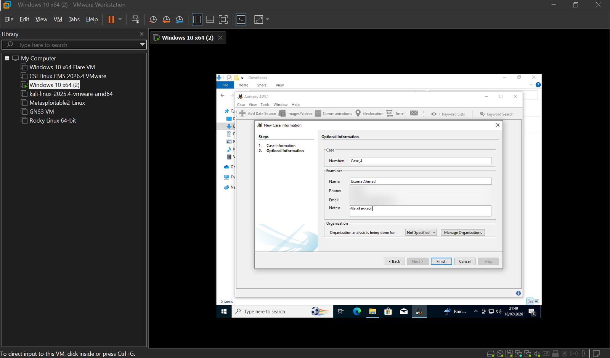
*Autopsy 4.23.1, optional case information. (Contact details blurred.)*

### Step 2 · Add the data source

`Add Data Source → Disk Image or VM file`, then select the `.E01`. **Set the time zone to match the suspect machine.** If Autopsy's time zone and the image's time zone don't match, every timestamp in your timeline will be off. I used `Asia/Tashkent` for this image.

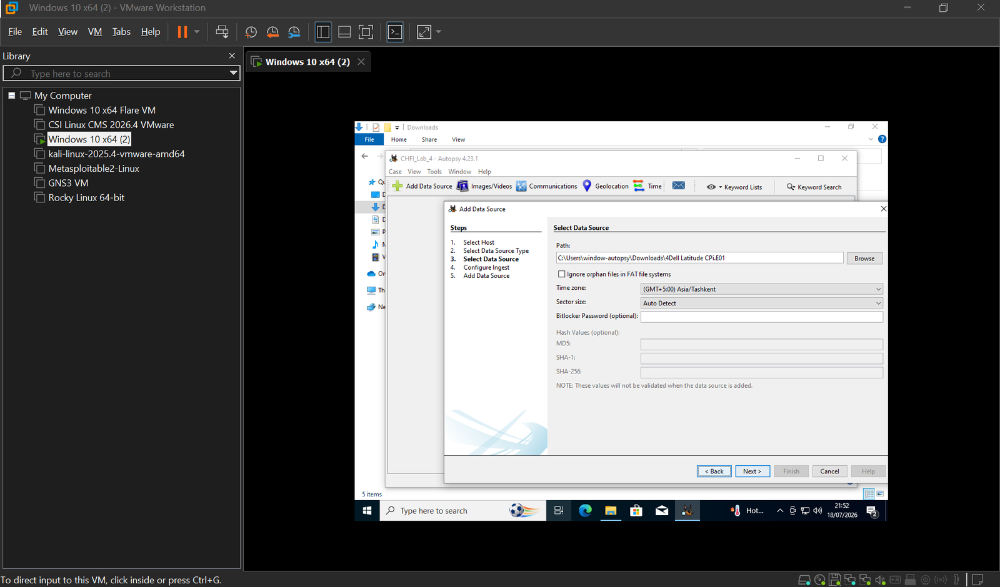
*Selecting the E01 image and its time zone.*

### Step 3 · Configure ingest modules

Ingest modules decide what Autopsy extracts. Choose only what the image needs, since large images take a long time.

**Important lesson:** my first run missed artifacts because I hadn't enabled the keyword lists for **phone numbers, IP addresses, email addresses, URLs and credit-card numbers**. Without them the *Data Artifacts* section stays empty. I deleted the case, re-ran with those lists ticked, and the artifacts appeared.

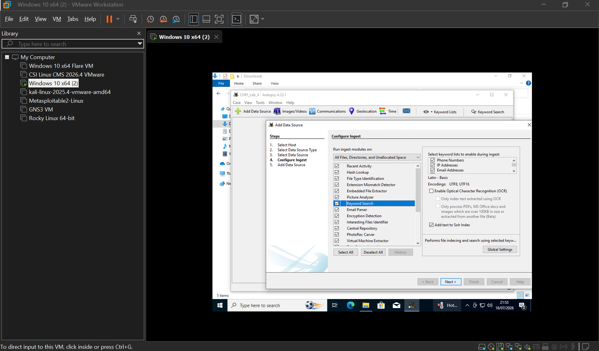
*Recent Activity, Hash Lookup, File Type ID, Extension Mismatch Detector, Keyword Search, PhotoRec Carver and others enabled.*

What the key modules do:

| Module | Purpose |
|---|---|
| Recent Activity | Browser history, cookies, bookmarks, registry-derived artifacts |
| Hash Lookup | Flag known-good / known-bad files |
| File Type Identification | Identify files by content, not extension |
| Extension Mismatch Detector | Find files whose extension doesn't match their real type |
| Keyword Search | Index and search text, including unallocated space |
| PhotoRec Carver | Recover deleted files from unallocated space (data carving) |

### Step 4 · Search for evidence

With ingest finished, I used **Keyword Search** to look for known hacking-tool names and user identities. Each search opens as its own result tab.

**Search: `CAIN.EXE`.** 20 hits, including Prefetch entries, a shortcut (`Cain v2.5.lnk`), registry data and `$MFT` references.

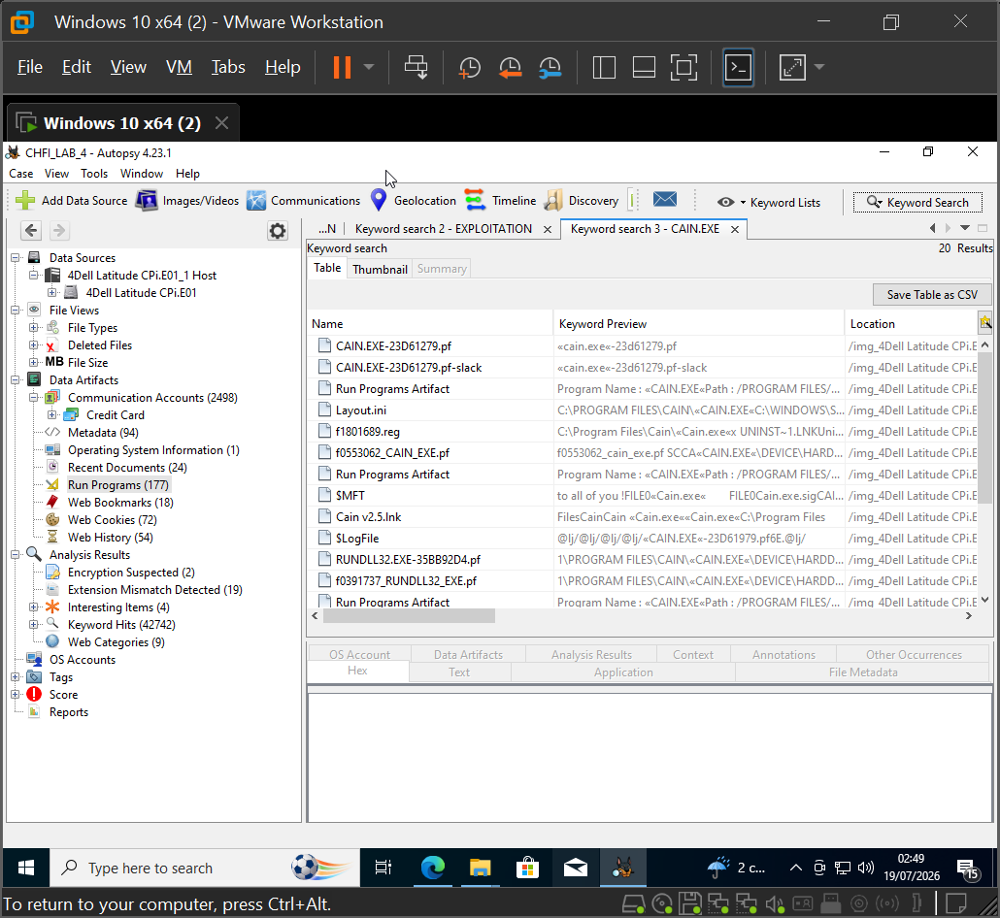

**Search: `ethereal.exe`.** 21 hits, including Prefetch entries and the program path.

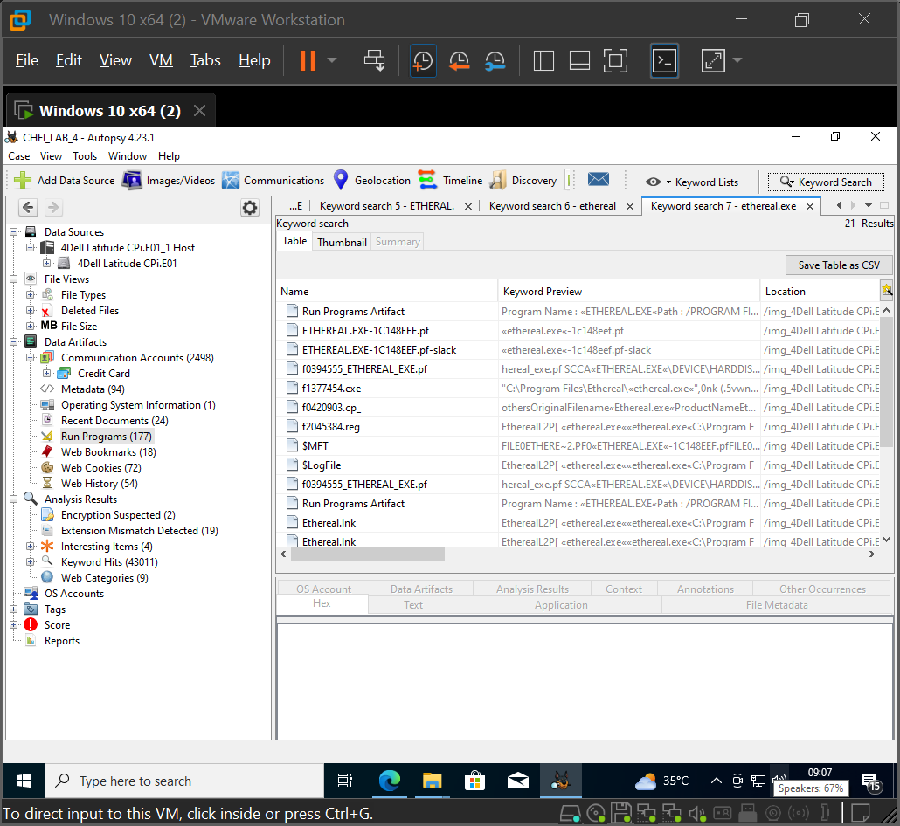

**Search: `netstumbler.exe`.** 27 hits, including copies in unallocated space.

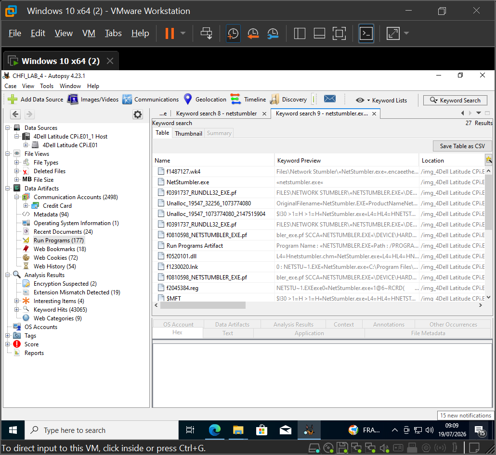

**Search: `winpcap`.** 18 hits, including an install page and an entry referencing the user's Desktop.

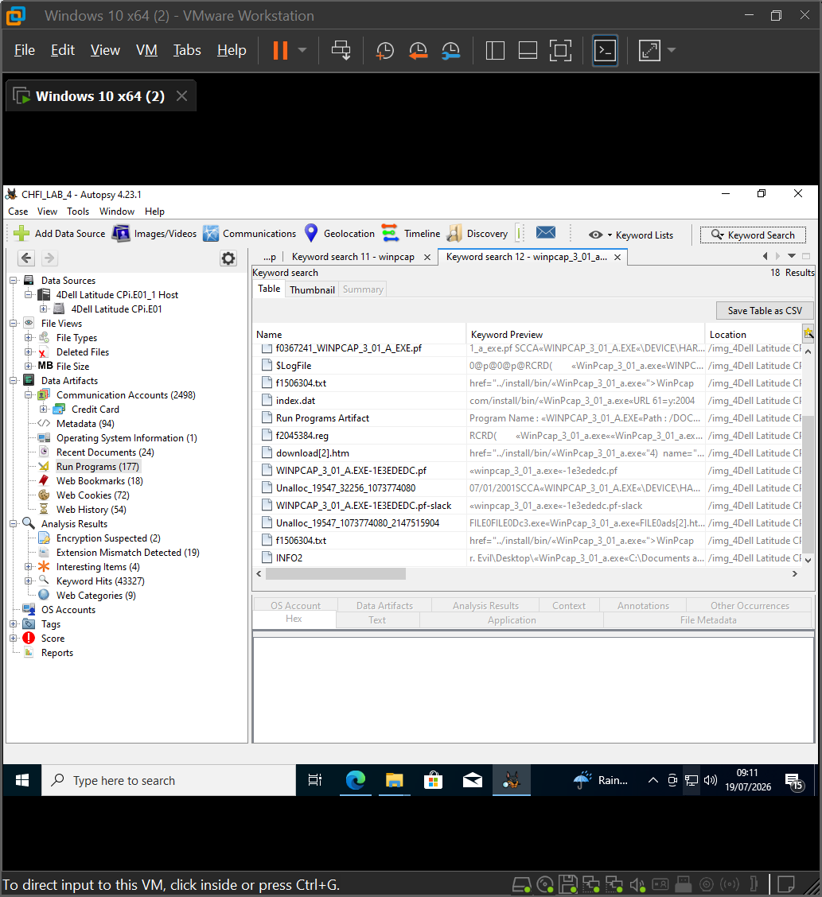

**Carved network capture.** A search for `f0290502.pcap` found a `.pcap` file recovered by the carver from the volume's `$CarvedFiles` folder. The left-hand tree also shows the credit-card BIN grouping from the earlier ingest.

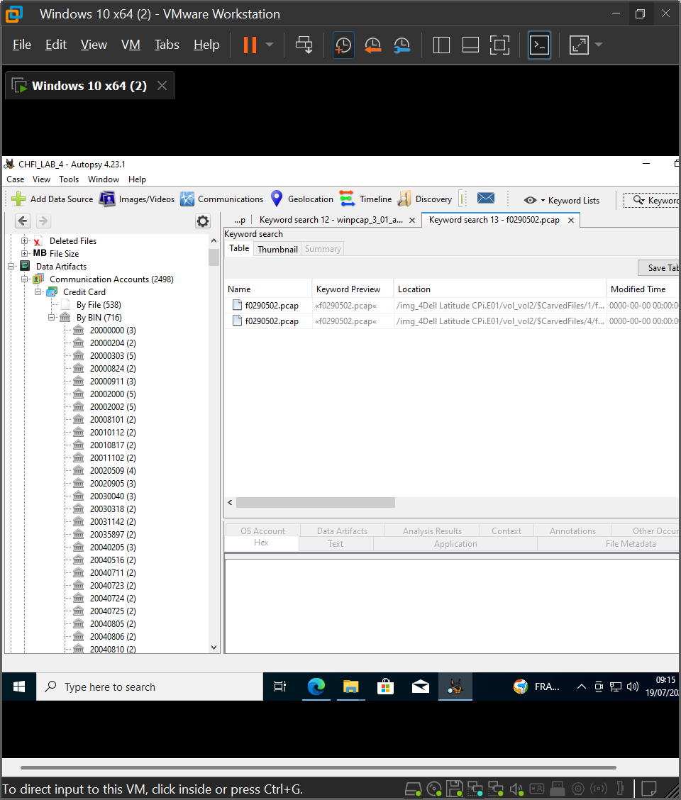

### Step 5 · Browser artifacts

`Data Artifacts → Web Cookies` lists cookies by user profile and site.

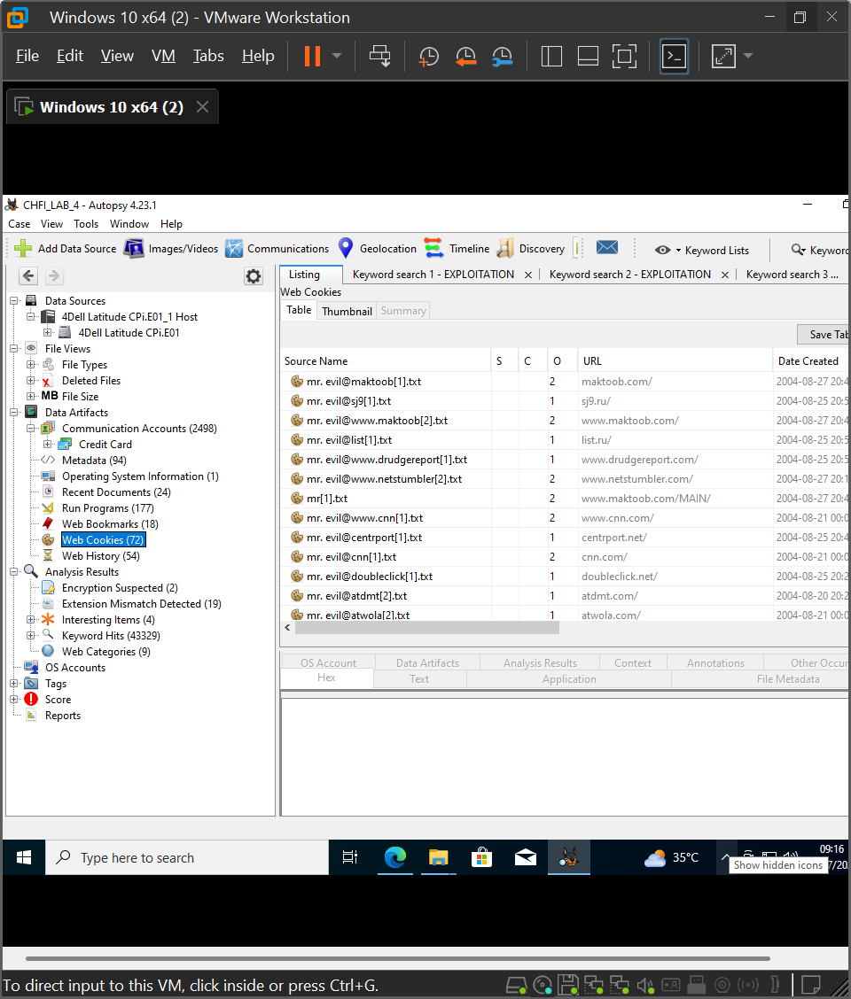
*72 cookies for the suspect profile (news, ad networks, webmail and a network-scanning site).*

Searching on the profile name returned **227 hits**, including Prefetch entries for a password-recovery tool installer (123 WASP), a Cain installer, `RUNDLL32`, `REGSVR32` and a web-history artifact.

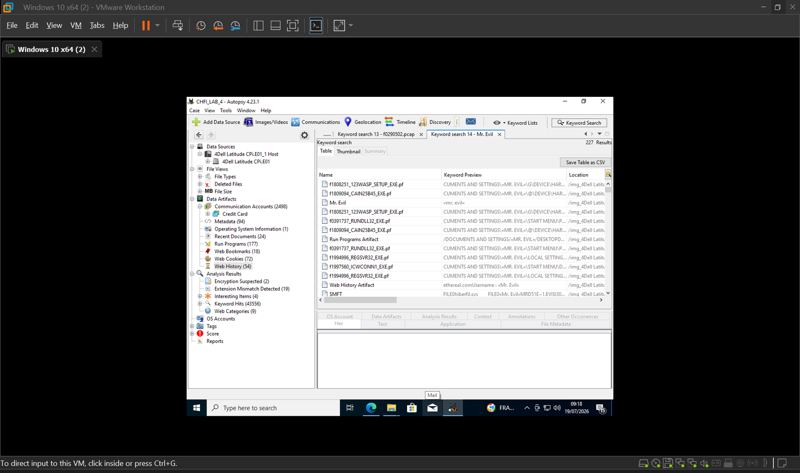

Searching on an account-name string produced 7 hits, including cached identity pages (`id_check[1].htm`, `Yahoo_ID_Helper.html`) and unallocated space. This is how a deleted or cached web identity can be tied back to a machine.

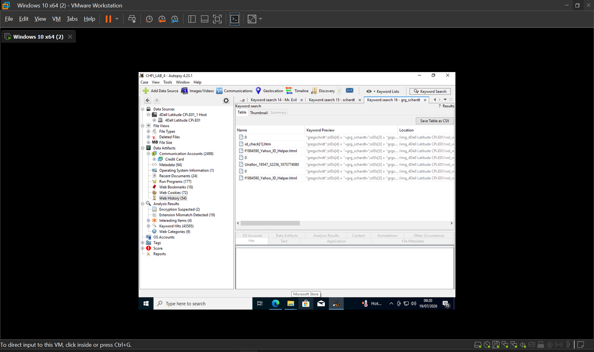

### Step 6 · Re-run with a fuller ingest

A second case (`CHFI_LAB_4_2`) with a broader ingest configuration surfaced additional artifact types such as **Installed Programs, Shell Bags, USB Device Attached, Web Search** and **E-Mail Messages**.

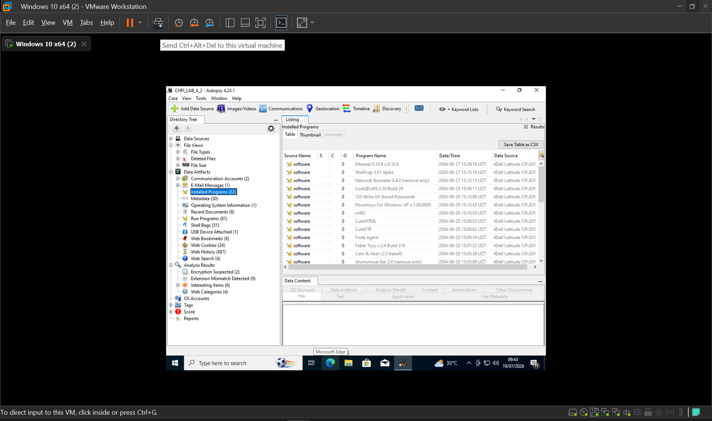
*32 installed programs, including Ethereal, WinPcap, Network Stumbler, Look@LAN, Cain & Abel, mIRC and Anonymizer Bar, each with an install timestamp.*

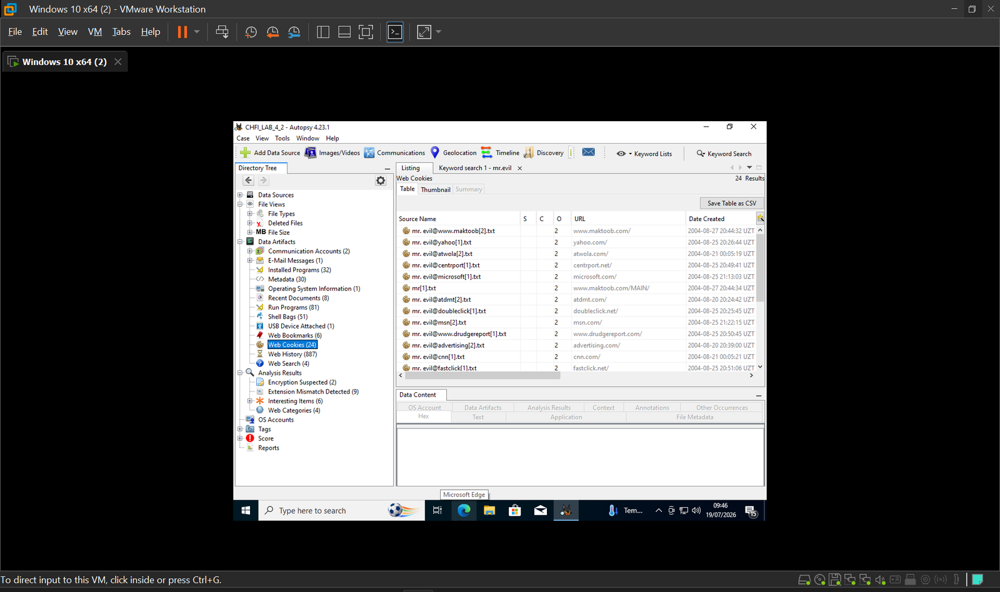
*Cookies reappear in the second case, which cross-checks the first.*

> The two cases show different counts (for example web history 54 vs 887) because they used **different ingest settings**. That is expected, but it's worth recording which configuration produced which numbers.

---

## 4. Findings

Summary of what the evidence on the image shows (Autopsy 4.23.1, case `CHFI_LAB_4`):

| Artifact | Count |
|---|---|
| Accounts: credit-card matches | 2,498 |
| Encryption suspected | 2 |
| Extension mismatch detected | 19 |
| Interesting items | 4 |
| Metadata | 94 |
| Recent documents | 24 |
| Run programs (Prefetch) | 177 |
| Web bookmarks | 18 |
| Web cookies | 72 |
| Web history | 54 |

**Interpretation**

- Prefetch, shortcuts, registry and `$MFT` entries show that network-sniffing and password-recovery tools (Cain & Abel, Ethereal, NetStumbler, WinPcap) were **installed and executed** under one user profile, with dates in August 2004.
- Many hits sit in **unallocated space and slack space** (`Unalloc_…`, `.pf-slack`), which means the files or traces were deleted but not wiped. This is where carving and keyword search on the full image pay off.
- The 2,498 credit-card matches come from pattern matching on raw text. **Treat these as leads, not proof**, because regex matches produce false positives and each one needs validating.

---

## 5. Reporting

`Tools → Generate Report`, choose **HTML** (other options: XLSX, CSV), select *All Results* (or tagged / specific results), pick an output folder, and open the report.

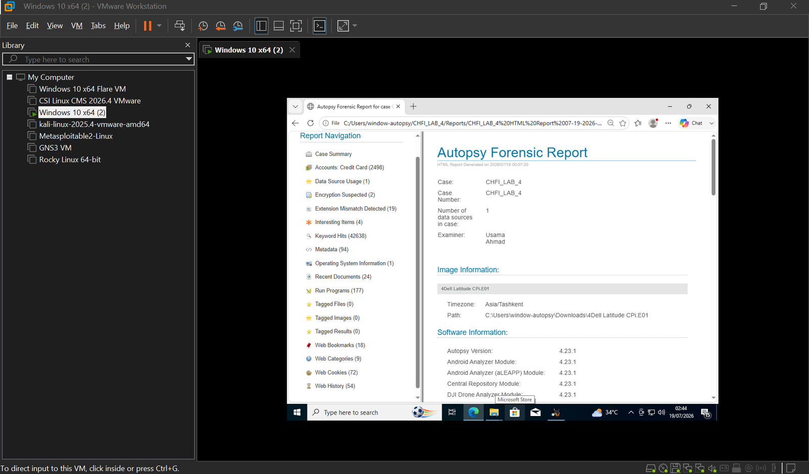
*The generated report: case summary, image information, software versions and a navigation tree of every artifact category.*

Why it matters: the report is the deliverable. It states the examiner, the image path and time zone, and every software module version used, which makes the work **repeatable and defensible**.

---

## 6. Memory forensics with Volatility

> Memory is volatile, so capture it first and **don't touch the live system** (don't even type commands on it). Image the RAM with FTK Imager, then analyse the image offline.

**What memory analysis reveals:** running and hidden processes (with parent–child relationships), open network connections, injected code, hidden DLLs and rootkits, encryption keys and password hashes, and console command history.

### Workflow

1. Acquire the RAM image from a live or imaged system.
2. **Profile** the image so Volatility reads the memory structures correctly.
3. Run plugins.
4. Analyse and report.

### Useful plugins

| Plugin | Purpose |
|---|---|
| `pslist` / `pstree` | List running processes and their hierarchy |
| `psxview` | Reveal hidden or unlinked processes by cross-checking several views |
| `netscan` | Reveal active and past network connections |
| `malfind` | Detect injected code and suspicious memory regions |
| `memdump` | Dump a process's memory for further analysis |

### Practice samples

Public memory samples from the Volatility Foundation wiki (for example *Cridex* and *R2D2*, both Windows XP SP2 x86), which are safe to use in an isolated lab.

### Example commands (Volatility 2)

```bash
# Identify the profile first
volatility -f 0zapftis.vmem imageinfo

# Processes
volatility -f 0zapftis.vmem --profile=WinXPSP3x86 pslist
volatility -f 0zapftis.vmem --profile=WinXPSP3x86 pstree
volatility -f 0zapftis.vmem --profile=WinXPSP3x86 psxview

# Injected code
volatility -f 0zapftis.vmem --profile=WinXPSP3x86 malfind

# Network connections
volatility -f 0zapftis.vmem --profile=WinXPSP3x86 netscan

# Dump a suspicious process (PID 228 in my lab)
volatility -f 0zapftis.vmem --profile=WinXPSP3x86 memdump -p 228 --dump-dir .
```

> **Note:** `netscan` targets Vista and later. On Windows XP images use `connections`, `connscan`, `sockets` or `sockscan` instead. Use whichever `imageinfo` says the profile supports.

<!-- TODO: add Volatility screenshots (pslist/pstree/malfind/netscan output) to an images/ subfolder and embed them here -->

**Concepts worth knowing:** a *zombie process* is finished but still in the process table. Malware likes to look like one because it breaks the parent–child chain. A *hidden* process is running but unlinked from the normal process list, which is what `psxview` exposes.

---

## 7. Bonus: SIEM telemetry with Wazuh + Sysmon

Brief notes from a related lab. By default a Windows agent only sends minimal logs (logons and failures). Adding **Sysmon** with a community config template produces rich process, network and file telemetry without drowning the SIEM in noise.

1. On the SIEM (CSI Linux), add a Windows agent in the Wazuh dashboard, set the manager IP and agent name, and copy the generated install command.
2. On the Windows 10 VM, run the command as admin, then confirm the agent via the `ossec` folder.
3. Download **Sysmon** (Sysinternals) and a Sysmon config template (SwiftOnSecurity `sysmon-config`).
4. Install with the template (admin PowerShell, from the Sysmon folder):

```powershell
.\Sysmon.exe -accepteula -i sysmonconfig-export.xml
sysmon -c      # verify the loaded configuration
```

5. Add the Sysmon event channel to the agent's `ossec.conf`, restart the agent, and filter in Wazuh Analytics on `rule.description`.

**Why Wazuh:** it aggregates logs from many sources and acts as an XDR. Correlating endpoint, email and network data gives the full picture of an incident, and the alerts become your evidence.

---

## 8. Lessons learned

- **Ingest configuration decides what you find.** A missing keyword list looks like "no evidence".
- **Match time zones** between the tool and the image, or your timeline is wrong.
- **Hash and document everything**; integrity and chain of custody are what make evidence usable.
- **Deleted is not gone.** Unallocated space and slack space held most of the interesting traces.
- **Cross-check** results (for example two cases, multiple keyword searches) before drawing conclusions.
- Some formats aren't supported directly, such as `.vdi`. Convert to RAW/DD first.

---

*Lab work performed on a public training image in an isolated virtual environment.*

[Browse more of my work on GitHub ↗](https://github.com/UsamaAhmad360?tab=repositories)
